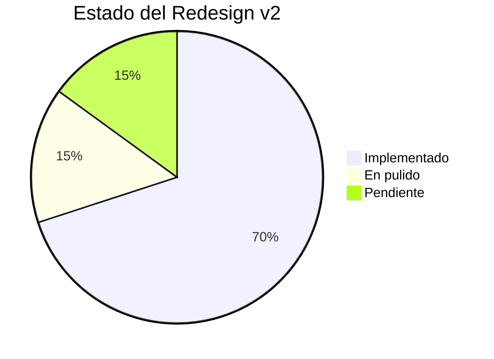

# 🏠 Creapolis Design Hub

> Centro de comando para el diseño y desarrollo de [creapolis.dev](https://creapolis.dev)
> **Versión**: v2 implementada — actualizado Abril 2026

---

## 🎯 Quick Links

| Recurso | Descripción | Estado |
|--------|-------------|--------|
| [[🎨 Design System]] | oklch palette, fonts, componentes v2 | ✅ Implementado |
| [[🧩 Component API]] | Props y uso de Nav/Footer/Ribbon | ✅ Nuevo |
| [[📋 Roadmap]] | Fases del redesign y trabajo pendiente | 🔄 En ejecución |
| [[📝 Content Strategy]] | Estrategia de contenido blog | ✅ Completo |
| [[🔍 Competitor Analysis]] | Apple + Google + agencias | ✅ Documentado |
| [[🛠️ Technical Stack]] | Stack técnico actual | ✅ Actualizado |

---

## 📊 Estado real del proyecto



### ✅ Lo que YA está en producción

- **Design system v2 oklch** — global.css migrado, tokens de color multi-hue, escala fluida, shadows y radii.
- **Google Fonts**: Geist + Geist Mono + Instrument Serif cargadas desde Layout.
- **Componentes compartidos**: `Nav.astro`, `Footer.astro`, `Ribbon.astro`.
- **Homepage v2** completa: hero con ribbon + showcase, marquee trust strip, product cards con device mockups, shelf "en desarrollo", servicios grid, proceso de 4 pasos, mission section dark, bloque "Notas" (últimos del blog) y contacto.
- **Blog**: listing con featured + grid + tags color-coded, detalle con hero oscuro y prose styles premium. 13 posts publicados.
- **Servicios v2**: hero, tarjetas de servicio con features + tech, proceso, tech cloud, contacto.
- **Contacto v2**: sidebar con promesa + email + pasos, formulario con type picker y budget picker, FAQ.
- **Proyectos index v2** y **Solennix page** con estilo completo.
- **Backend Go** funcionando para formulario de contacto.

### ⚠️ Lo que sigue flojo

- **`proyectos/[slug].astro`** — template genérico sin hero ni animaciones. Pepinillo y Películas se ven pobres al lado de Solennix.
- **`privacidad.astro` / `terminos.astro`** — contenido esqueleto, sólo párrafos centrados sin diseño.
- **Proyectos hardcoded** en `[slug].astro` en vez de content collection.
- **Sin página "sobre nosotros"** ni testimonios visibles (la confianza se vende con caras y nombres).
- **Sin página 404** personalizada.
- **Dark mode** preparado en CSS pero sin toggle ni persistencia.
- **SEO**: falta Schema.org BlogPosting/Organization y OG images dinámicas.

---

## 🎨 Design System v2 — Resumen

### Paleta multi-hue

| Color | oklch | Uso principal |
|-------|-------|---------------|
| ██ Iris | `oklch(0.62 0.2 285)` | Brand principal, tech, mobile tag |
| ██ Coral | `oklch(0.72 0.18 32)` | Energía, featured, IA tag |
| ██ Lime | `oklch(0.84 0.18 128)` | Live, éxito, web tag |
| ██ Sky | `oklch(0.72 0.14 235)` | Confianza, flutter/native tag |
| ██ Amber | `oklch(0.78 0.16 70)` | Alerta, premium, pricing tag |

Cada accent tiene variante `*-soft` para fondos suaves.

### Fonts

- **Sans**: Geist (body, UI, headings base)
- **Serif**: Instrument Serif italic (keywords dentro de headings, bignums, stats)
- **Mono**: Geist Mono (eyebrows, captions, tags, fechas)

### Firma visual

- Serif italic como acento de marca en 1–2 palabras por heading.
- Ribbon SVG curvo como motif decorativo (hero y mission).
- Nav pill flotante con blur al hacer scroll.
- Chips de status (live / beta / dev / soon) con color accent.
- Animación `reveal` con stagger (`reveal-delay-1..3`).

> Ver [[🎨 Design System]] para documentación completa.

---

## 📁 Estructura real del proyecto

```
creapolis/
├── src/
│   ├── components/              ✅ Implementado
│   │   ├── Nav.astro           — pill flotante con links + CTA
│   │   ├── Footer.astro        — columnas + links + copyright
│   │   └── Ribbon.astro        — SVG decorativo reutilizable
│   ├── content/
│   │   ├── blog/               — 13 posts Markdown
│   │   └── config.ts           — Zod schemas (blog + proyectos definido, no poblado)
│   ├── layouts/
│   │   └── Layout.astro        — fonts + meta + reveal script
│   ├── pages/
│   │   ├── index.astro         ✅ v2 completo (hero, marquee, products, shelf, services, process, mission, notas, contact)
│   │   ├── servicios.astro     ✅ v2
│   │   ├── contacto.astro      ✅ v2
│   │   ├── solennix.astro      ✅ v2
│   │   ├── privacidad.astro    ⚠️ esqueleto
│   │   ├── terminos.astro      ⚠️ esqueleto (bug de encoding corregido)
│   │   ├── blog/
│   │   │   ├── index.astro     ✅ v2 featured + grid
│   │   │   └── [slug].astro    ✅ v2 hero oscuro + prose
│   │   └── proyectos/
│   │       ├── index.astro     ✅ v2
│   │       └── [slug].astro    ⚠️ template plano, data hardcoded
│   └── styles/
│       └── global.css          ✅ v2 tokens oklch
├── backend/                     ✅ Go HTTP para formulario
├── public/                      — favicon, robots, sitemap
└── creapolis_dev_page/          — este Obsidian vault
```

---

## 🐛 Issues abiertos

| # | Issue | Severidad |
|---|-------|-----------|
| 1 | `proyectos/[slug].astro` genérico — Pepinillo y Películas sin página propia estilo Solennix | 🔴 Alta |
| 2 | Proyectos data hardcoded en `[slug].astro` en vez de content collection | 🟡 Media |
| 3 | Sin testimonios / client quotes / caras visibles | 🔴 Alta (vende consultoría) |
| 4 | Sin página "sobre nosotros" / equipo | 🟡 Media |
| 5 | Legales (`privacidad`, `terminos`) con contenido skeleton | 🟡 Media |
| 6 | Formulario apunta a `localhost:3000` en prod | 🟡 Media |
| 7 | Sin página 404 personalizada | 🟢 Baja |
| 8 | Dark mode CSS listo pero sin toggle | 🟢 Baja |
| 9 | Sin Schema.org ni OG images dinámicas | 🟡 Media (SEO) |
| 10 | Copy de servicios repetitivo, sin diferenciación real | 🟡 Media |

> Ver [[📋 Roadmap]] para plan detallado.

---

## 📝 Próximas acciones (abril–mayo 2026)

### Sprint actual

1. ✅ Arreglar bug de encoding en `terminos.astro` (texto chino)
2. ✅ Agregar bloque "Notas" (últimos posts del blog) al home
3. 🔄 Reescribir Home.md y Roadmap.md para reflejar realidad
4. 🔄 Documentar API de componentes (Nav, Footer, Ribbon)

### Siguiente

5. Rediseñar `proyectos/[slug].astro` al nivel de `solennix.astro`
6. Página "Sobre nosotros" + sección de testimonios con caras reales
7. Reescribir copy de servicios con diferenciación + mini case studies
8. Expandir contenido legal real

### Después

9. Migrar proyectos a content collection
10. Toggle de dark mode + persistencia
11. Schema.org + OG images dinámicas (satori)
12. Lighthouse audit + optimización

---

## 📈 Métricas objetivo

| Métrica | Estado | Objetivo |
|--------|--------|----------|
| Lighthouse Performance | sin medir | 95+ |
| Lighthouse Accessibility | sin medir | 95+ |
| Lighthouse SEO | sin medir | 90+ |
| CLS | sin medir | < 0.1 |
| FCP | sin medir | < 1.5s |
| Blog posts | 13 | 24 / año |
| Páginas v2 completas | 7 / 10 | 10 / 10 |

---

## 🔗 Links del proyecto

- **Live**: [creapolis.dev](https://creapolis.dev)
- **Repo local**: `/Users/tiagofur/dev/astro_creapolis/creapolis/`
- **Vault**: `creapolis_dev_page/`

---

## 🏷️ Tags

#status/active #year/2026 #redesign #creapolis-v2
