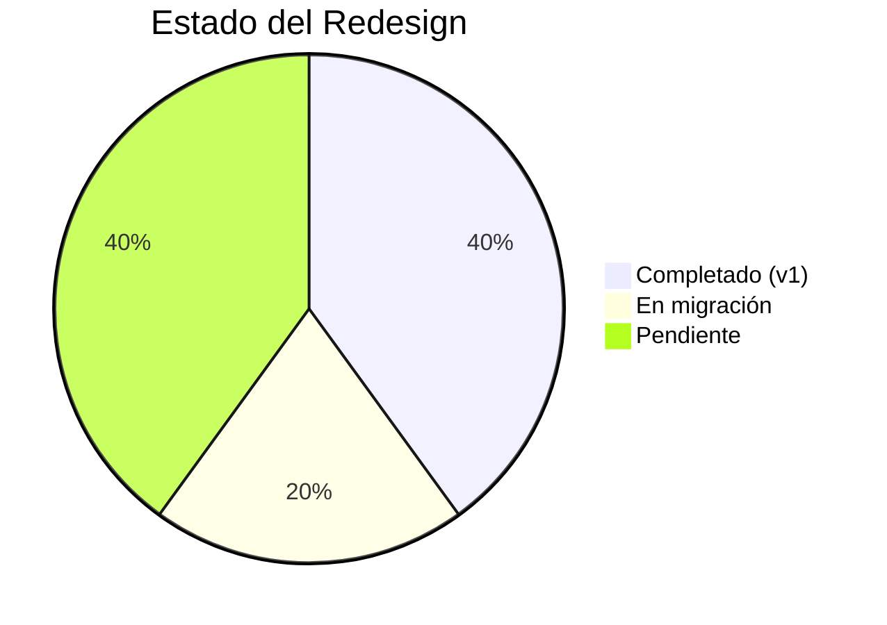

# 🏠 Creapolis Design Hub

> Centro de comando para el diseño y desarrollo de [creapolis.dev](https://creapolis.dev)
> **Versión**: v2 Redesign — Abril 2026

---

## 🎯 Quick Links

| Recurso | Descripción | Estado |
|--------|-------------|--------|
| [[Design System]] | oklch palette, fonts, componentes v2 | 🔄 En migración |
| [[Roadmap]] | Fases del redesign completo | 📋 Pendiente |
| [[Content Strategy]] | Estrategia de contenido blog | ✅ Completo |
| [[Competitor Analysis]] | Apple + Google + agencias | ✅ Documentado |
| [[Technical Stack]] | Stack técnico actual | 🔄 Actualizando |

---

## 📊 Estado del Proyecto



### Versión actual (v1 — Apple style)

- ✅ Astro 5.0+ con Content Collections
- ✅ 12 blog posts publicados
- ✅ Backend Go para formulario
- ✅ RSS + Sitemap
- ✅ 7 páginas funcionales

### Versión objetivo (v2 — Creapolis identity)

- 🔲 Design system oklch multi-hue
- 🔲 Google Fonts (Geist + Instrument Serif)
- 🔲 Componentes Astro (Nav, Footer, Ribbon)
- 🔲 Homepage con ribbon motif + showcase
- 🔲 Blog premium con prose styles
- 🔲 Dark mode

---

## 🎨 Design System v2 — Resumen

### Paleta Multi-hue

| Color | oklch | Uso |
|-------|-------|-----|
| ██ Iris | `oklch(0.62 0.2 285)` | Brand principal, tech |
| ██ Coral | `oklch(0.72 0.18 32)` | Energía, featured |
| ██ Lime | `oklch(0.84 0.18 128)` | Live, éxito |
| ██ Sky | `oklch(0.72 0.14 235)` | Confianza, info |
| ██ Amber | `oklch(0.78 0.16 70)` | Alerta, premium |

### Fonts

- **Sans**: Geist (body, UI)
- **Serif**: Instrument Serif italic (keywords en headings)
- **Mono**: Geist Mono (captions, code, eyebrows)

### Firma visual

- Serif italic en headings (máximo 1-2 palabras)
- Ribbon SVG curvo como fondo decorativo
- Nav pill flotante (cápsula con blur)
- Chips de status (live/beta/dev/soon)

> Ver [[Design System]] para documentación completa

---

## 📁 Estructura del Proyecto

```
apple_style/
├── src/
│   ├── components/        ← NUEVO (Nav, Footer, Ribbon)
│   ├── content/
│   │   ├── blog/          # 12 Markdown posts
│   │   ├── proyectos/     # ← VACÍO (migrar data)
│   │   └── config.ts      # Zod schemas
│   ├── layouts/
│   │   └── Layout.astro   # ← Actualizar con fonts
│   ├── pages/
│   │   ├── index.astro    # ← Rediseñar completo
│   │   ├── servicios.astro
│   │   ├── contacto.astro
│   │   ├── solennix.astro
│   │   ├── blog/
│   │   │   ├── index.astro
│   │   │   └── [slug].astro
│   │   └── proyectos/
│   │       ├── index.astro
│   │       └── [slug].astro
│   └── styles/
│       └── global.css     # ← Reescribir con v2 tokens
├── backend/               # Go API (contact form)
├── public/                # favicon, robots, sitemap
└── creapolis_dev_page/    # ← Este Obsidian vault
```

---

## 🐛 Issues Conocidos

| # | Issue | Severidad |
|---|-------|-----------|
| 1 | Nav/Footer copiados en 8 páginas | 🔴 CRÍTICO |
| 2 | Proyectos collection vacía | 🟡 Medio |
| 3 | Data hardcoded en `[slug].astro` | 🟡 Medio |
| 4 | Formulario → localhost:3000 | 🟡 Medio |
| 5 | No hay 404 page | 🟢 Bajo |
| 6 | Favicon placeholder | 🟢 Bajo |
| 7 | Typos en español | 🟢 Bajo |

> Ver [[Roadmap]] para plan completo de correcciones

---

## 📝 Próximas Acciones

### Esta semana

1. Componentizar Nav + Footer en `src/components/`
2. Reescribir `global.css` con tokens v2
3. Actualizar `Layout.astro` con Google Fonts

### Próxima semana

4. Rediseñar homepage completo
5. Blog listing + detail con nuevo estilo

### Este mes

6. Todas las páginas internas migradas
7. Dark mode toggle
8. Performance audit

---

## 📈 Métricas Objetivo

| Métrica | v1 Actual | v2 Objetivo |
|--------|-----------|-------------|
| Lighthouse Performance | ? | 95+ |
| Lighthouse Accessibility | ? | 95+ |
| Lighthouse SEO | ? | 90+ |
| CLS (Cumulative Layout Shift) | ? | < 0.1 |
| FCP (First Contentful Paint) | ? | < 1.5s |
| Blog posts | 12 | 24/año |

---

## 🔗 Links del Proyecto

- **Live**: [creapolis.dev](https://creapolis.dev)
- **Repo**: `/apple_style/`
- **Prototipo v2**: `/inspirations/`
- **Otras versiones**: `/colorful/`, `/modern/`

---

## 🏷️ Tags

#status/active #year/2026 #redesign #creapolis-v2
