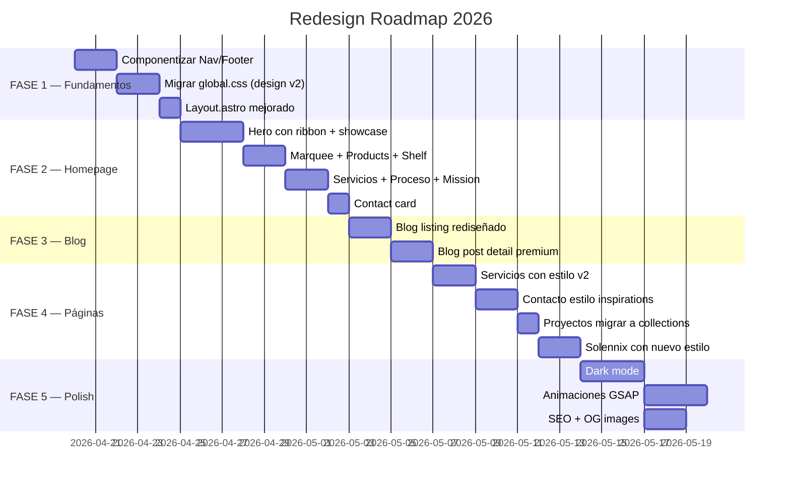

# 📋 Roadmap — Creapolis v2 Redesign

> Plan de rediseño completo: migrar design system de `inspirations/` al proyecto Astro `apple_style/`
> **Última actualización**: Abril 2026

---

## 🚦 Estado General

---

## 🎯 FASE 1 — Fundamentos

> **Prerequisito**: Todo lo demás depende de esto. No avanzar sin completar.

### 1.1 — Componentizar Nav + Footer

**Problema**: Nav y footer están COPIADOS en 8 páginas. Cambiar un link = editar 8 archivos.

**Solución**: Crear componentes Astro reutilizables.

| Archivo | Contenido |
|---------|-----------|
| `src/components/Nav.astro` | Nav pill flotante, logo mark, links, CTA, burger |
| `src/components/Footer.astro` | Footer con columns, links, copyright |
| `src/components/Ribbon.astro` | SVG decorativo reutilizable (acepta variantes) |

**Checklist**:
- [ ] Crear `Nav.astro` con estilo pill flotante del design system v2
- [ ] Crear `Footer.astro` con estilo columns de inspirations
- [ ] Crear `Ribbon.astro` como componente reutilizable
- [ ] Reemplazar nav/footer en TODAS las páginas
- [ ] Verificar mobile menu funcional

### 1.2 — Migrar Design System CSS

**Problema**: `global.css` usa colores hex planos, system fonts, estilo Apple genérico.

**Solución**: Reescribir con tokens oklch del prototipo inspirations.

**Cambios clave en `global.css`**:
- [ ] Reemplazar `:root` con variables oklch (ver [[Design System]])
- [ ] Agregar Google Fonts: Geist + Geist Mono + Instrument Serif
- [ ] Agregar classes: `.serif`, `.eyebrow`, `.chip`, `.ribbon`
- [ ] Agregar `.reveal` con el sistema de animaciones nuevo
- [ ] Agregar `.marquee` keyframe
- [ ] Agregar radii: `--r-sm` a `--r-xl`
- [ ] Agregar shadows con oklch
- [ ] Actualizar buttons: `.btn-primary` usa `var(--ink)` no azul

### 1.3 — Layout.astro mejorado

- [ ] Agregar Google Fonts preload + stylesheet
- [ ] Agregar `font-feature-settings: "ss01", "cv11"` en body
- [ ] Actualizar meta theme-color
- [ ] Script: reveal observer + nav scroll + ribbon parallax

---

## 🏠 FASE 2 — Homepage (`index.astro`)

> Rediseño completo basado en `inspirations/index.html`

### 2.1 — Hero Section

- [ ] Grid 2 cols (1.25fr + 1fr en desktop)
- [ ] Copy side: eyebrow, h1 con serif accent, lead, CTAs, trust strip
- [ ] Showcase side: 3 cards absolutas (phone, stat, chart)
- [ ] Ribbon SVG de fondo con parallax
- [ ] Radial gradients como fondo (iris-soft, coral-soft, lime-soft)

### 2.2 — Marquee Trust Strip

- [ ] Ticker horizontal con animación `marquee 32s linear infinite`
- [ ] Background `var(--ink)`, texto `var(--paper)`
- [ ] Items: "Código propio, no plantillas" etc.
- [ ] Separadores ✦ en coral

### 2.3 — Products Section

- [ ] Cards con glow radial + device mockup
- [ ] Chip "Live" verde
- [ ] Tagline en serif italic con color del producto
- [ ] Shelf "en desarrollo" con progress bars
- [ ] Chips: Beta, Dev, Soon con colores

### 2.4 — Servicios Section

- [ ] Grid 4 cols con icon marks (serif italic)
- [ ] Cada servicio con su accent color
- [ ] Hover con border-color del accent

### 2.5 — Proceso Section

- [ ] Cards con bignum serif (5rem)
- [ ] Colores alternados: iris → coral → lime → amber

### 2.6 — Mission Section

- [ ] Background `var(--ink)`, texto claro
- [ ] Stats con números serif en colores
- [ ] Ribbon SVG decorativo

### 2.7 — Contact CTA

- [ ] Card con gradient glow
- [ ] Mini formulario inline

---

## 📝 FASE 3 — Blog

### 3.1 — Blog Listing (`blog/index.astro`)

- [ ] Hero con eyebrow + título con serif accent
- [ ] Cards de post con:
  - [ ] Fecha en mono + tags como chips
  - [ ] Título con hover effect
  - [ ] Descripción truncada (-webkit-line-clamp: 2)
  - [ ] Barra de color accent por tag
- [ ] Featured post (primer post) con layout grande
- [ ] Grid responsive: 1 → 2 → 3 cols

### 3.2 — Blog Post Detail (`blog/[slug].astro`)

- [ ] Back link "← Volver al blog"
- [ ] Article header: tags, date, title, description
- [ ] Content area max-width 720px
- [ ] Prose styles mejoradas:
  - [ ] `h2` con border-top y spacing
  - [ ] `blockquote` con border-left iris
  - [ ] `code` inline con bg chalk
  - [ ] `pre` con bg ink + radius
  - [ ] Links con underline + color iris
- [ ] "Artículos relacionados" al final
- [ ] Share buttons (Twitter, LinkedIn, copy link)
- [ ] Reading time estimado

---

## 🔧 FASE 4 — Páginas internas

### 4.1 — Servicios (`servicios.astro`)

- [ ] Hero con ribbon SVG
- [ ] Tabs pills con icon y color por servicio
- [ ] Features grid 2 cols dentro de cada servicio
- [ ] Tech badges como pills
- [ ] FAQ con details/summary estilo inspirations
- [ ] CTA card con glow

### 4.2 — Contacto (`contacto.astro`)

Basado en `inspirations/contacto.html`:
- [ ] Hero con eyebrow + título serif
- [ ] Grid 2 cols: sidebar + formulario
- [ ] Sidebar: promesa card (dark), email card, "qué pasa después"
- [ ] Type picker (radio cards seleccionables)
- [ ] Budget picker (pills seleccionables)
- [ ] FAQ section

### 4.3 — Proyectos

- [ ] Mover data hardcoded a content collections
- [ ] `proyectos/index.astro` con cards estilo inspirations
- [ ] `proyectos/[slug].astro` con hero, features, tech stack
- [ ] Solennix: mantener pricing + store links, aplicar nuevo estilo

### 4.4 — Páginas legales

- [ ] `privacidad.astro` y `terminos.astro` con styles nuevos
- [ ] Prose styles consistentes

---

## ✨ FASE 5 — Polish

### 5.1 — Dark Mode

- [ ] CSS variables para dark theme
- [ ] Toggle en nav (sol/luna icon)
- [ ] Persistir con localStorage
- [ ] Respetar `prefers-color-scheme`
- [ ] Transición suave entre modos

### 5.2 — Animaciones avanzadas

- [ ] Counter animado en stats (números que cuentan al scroll)
- [ ] Stagger reveals mejorados (cards aparecen una por una)
- [ ] SVG path drawing en ribbons
- [ ] Card tilt 3D sutil en hover
- [ ] Smooth scroll mejorado

### 5.3 — SEO

- [ ] OG images dinámicas (satori o vercel/og)
- [ ] Schema.org BlogPosting en posts
- [ ] Schema.org Organization en home
- [ ] Internal links entre posts relacionados
- [ ] Alt text en todas las imágenes

### 5.4 — Performance

- [ ] Lighthouse audit completo
- [ ] Image optimization (WebP)
- [ ] Font subsetting
- [ ] Preload critical assets

---

## 🐛 Issues conocidos (corregir durante redesign)

| # | Issue | Dónde | Severidad |
|---|-------|-------|-----------|
| 1 | Nav copiado en 8 páginas | Todas las páginas | 🔴 Alta |
| 2 | `proyectos/` collection vacía | `content/proyectos/` | 🟡 Media |
| 3 | Proyectos data hardcoded en `[slug].astro` | `proyectos/[slug].astro` | 🟡 Media |
| 4 | Fallback projects grid con CSS hack | `proyectos/index.astro` | 🟡 Media |
| 5 | Formulario apunta a `localhost:3000` | `contacto.astro` | 🟡 Media |
| 6 | No hay 404 page | `src/pages/` | 🟢 Baja |
| 7 | `#blog` link en nav va a sección que no existe | `index.astro` | 🟢 Baja |
| 8 | Favicon es placeholder básico | `public/favicon.svg` | 🟢 Baja |
| 9 | Algunos typos en español (ej: "ofrecemo s") | `servicios.astro` | 🟢 Baja |
| 10 | `solennix.astro` es una page separada, no usa `[slug]` | Pages | 🟡 Media |

---

## 📊 Progreso

### FASE 1 — Fundamentos

| Tarea | Estado |
|-------|--------|
| Componentizar Nav | 🔲 Pendiente |
| Componentizar Footer | 🔲 Pendiente |
| Crear Ribbon component | 🔲 Pendiente |
| Migrar global.css | 🔲 Pendiente |
| Layout.astro mejorado | 🔲 Pendiente |

### FASE 2 — Homepage

| Tarea | Estado |
|-------|--------|
| Hero con ribbon + showcase | 🔲 Pendiente |
| Marquee trust strip | 🔲 Pendiente |
| Products + Shelf | 🔲 Pendiente |
| Servicios cards | 🔲 Pendiente |
| Proceso section | 🔲 Pendiente |
| Mission + stats | 🔲 Pendiente |
| Contact card | 🔲 Pendiente |

### FASE 3 — Blog

| Tarea | Estado |
|-------|--------|
| Blog listing rediseñado | 🔲 Pendiente |
| Blog post premium | 🔲 Pendiente |

### FASE 4 — Páginas

| Tarea | Estado |
|-------|--------|
| Servicios estilo v2 | 🔲 Pendiente |
| Contacto estilo inspirations | 🔲 Pendiente |
| Proyectos en collections | 🔲 Pendiente |
| Solennix nuevo estilo | 🔲 Pendiente |
| Legales con nuevo estilo | 🔲 Pendiente |

### FASE 5 — Polish

| Tarea | Estado |
|-------|--------|
| Dark mode | 🔲 Pendiente |
| Animaciones GSAP | 🔲 Pendiente |
| SEO completo | 🔲 Pendiente |
| Performance audit | 🔲 Pendiente |

---

## ✅ Completado antes del redesign (Q1 2026)

- [x] Setup Astro project
- [x] Design System v1 (Apple style)
- [x] 12 Blog posts publicados
- [x] Proyectos catalog
- [x] Servicios page
- [x] Contact form con backend Go
- [x] Responsive design
- [x] Animation utilities
- [x] RSS feed
- [x] Sitemap + robots.txt
- [x] Obsidian vault con documentación

---

## 🏷️ Tags

#roadmap #redesign #priorities #creapolis-v2 #year-2026 #status/active
