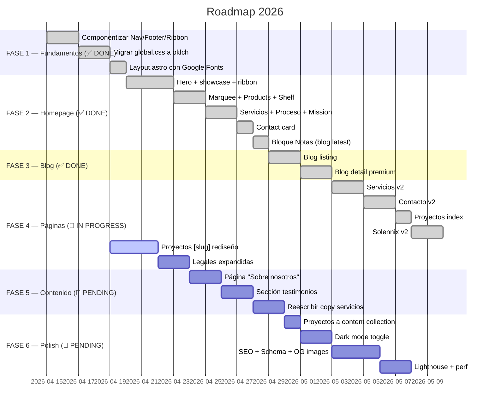

# 📋 Roadmap — Creapolis v2

> Plan de trabajo real del sitio. Migración inspirations → Astro completada en ~70%.
> **Última actualización**: Abril 2026

---

## 🚦 Estado general

---

## ✅ FASE 1 — Fundamentos (completado)

**Resultado**: base sólida del design system v2.

- ✅ `src/components/Nav.astro` — pill flotante con props `links` y `cta`.
- ✅ `src/components/Footer.astro` — columns con links + copyright.
- ✅ `src/components/Ribbon.astro` — SVG decorativo reutilizable.
- ✅ Reemplazo de Nav/Footer en las 10 páginas (antes copiado inline).
- ✅ `global.css` reescrito con tokens oklch, escala fluida, radii, shadows.
- ✅ Google Fonts: Geist + Geist Mono + Instrument Serif en `Layout.astro`.
- ✅ Classes utilitarias: `.serif`, `.eyebrow`, `.chip`, `.ribbon`, `.reveal`, `.marquee`.
- ✅ Legacy aliases CSS preservados para zero regressions.

---

## ✅ FASE 2 — Homepage (completado)

`index.astro` rediseñado con el patrón completo v2.

- ✅ Hero full-height con ribbon SVG de fondo + showcase cards (phone, stat, chart).
- ✅ Marquee trust strip con fondo `var(--ink)`.
- ✅ Product cards con device mockups + chips de status.
- ✅ Shelf "en desarrollo" con progress bars y rings.
- ✅ Servicios grid con accent marks en serif italic.
- ✅ Proceso con bignums serif alternados por color.
- ✅ Mission section dark con stats serif y ribbon.
- ✅ **Bloque "Notas"** con últimos 3 posts del blog (abril 2026).
- ✅ Contact CTA con mini formulario.

---

## ✅ FASE 3 — Blog (completado)

### 3.1 — `blog/index.astro`

- ✅ Header con eyebrow + título serif accent + decorative accents.
- ✅ Featured post (más reciente) con layout grande.
- ✅ Grid responsivo 1 → 2 → 3 cols.
- ✅ Cards con fecha mono, tags coloreados por categoría, título con hover, descripción truncada, barra accent por tag.
- ✅ 13 posts publicados.

### 3.2 — `blog/[slug].astro`

- ✅ Hero oscuro con tag colors y byline.
- ✅ Breadcrumb "← Volver" a blog.
- ✅ Prose styles premium (h2 con border-top, blockquote, code, pre, links iris).
- ⚠️ Pendiente: "artículos relacionados", share buttons, reading time estimado.

---

## 🔄 FASE 4 — Páginas internas (en progreso)

### ✅ 4.1 — `servicios.astro`

Hero con ribbon, tarjetas detalladas por servicio (Mobile, Web, Desktop, IA) con features + tech stacks + deliverables, proceso repetido, tech cloud de chips, formulario. Reveal animations.

### ✅ 4.2 — `contacto.astro`

Hero + grid 2 cols: sidebar (promesa card, email alt, 3-step process) + formulario con radio type picker + 6 budget pills + textarea. FAQ con 5 details/summary. Reveal animations.

### ✅ 4.3 — `proyectos/index.astro`

Hero + grid 3 cards de productos live (Solennix, Pepinillo, Películas) con device mockups.

### ✅ 4.3 — `solennix.astro`

Dedicated app page: hero, 6 feature cards, pricing table, testimonios, store badges iOS/Android.

### 🔄 4.4 — `proyectos/[slug].astro` (PENDIENTE — próximo sprint)

**Problema**: template genérico para Pepinillo y Películas se ve plano al lado de Solennix.

- [ ] Hero con ribbon SVG + accent color del producto
- [ ] Reveal animations
- [ ] Bloque de screenshots / device mockups reales
- [ ] Feature cards con mismo estilo que Solennix
- [ ] Tech stack como chips (no lista plana)
- [ ] Sección "cómo lo construimos" — breve case study
- [ ] Store links con badges estilizados
- [ ] CTA final relacionado al servicio

### 🔄 4.5 — Legales (PENDIENTE)

- [ ] ✅ Bug de encoding chino en `terminos.astro` corregido
- [ ] Contenido real en privacidad: qué datos, cookies específicas, terceros reales, derechos ARCO
- [ ] Contenido real en términos: garantías, SLA, ley aplicable, jurisdicción
- [ ] Prose styles consistentes con el sistema v2

---

## 🔲 FASE 5 — Contenido (prioridad alta, próximo)

> Esta fase es la que **más impacto de venta** tiene. Son consultoría y confianza.

### 5.1 — Página "Sobre nosotros"

- [ ] Foto / avatar del equipo
- [ ] Historia breve de Creapolis (desde 2020, Monterrey, estudio de producto)
- [ ] Filosofía: "código propio, no plantillas", obsesión por detalle, sprints con demo semanal
- [ ] Links a perfiles (GitHub, LinkedIn)
- [ ] CTA "agendar llamada"

### 5.2 — Sección de testimonios

- [ ] Mínimo 3 quotes con **nombre real + cargo + empresa + foto**
- [ ] Integrar en: home (bloque nuevo entre mission y notas), solennix, contacto
- [ ] Priorizar quotes con métricas (ej: "+42% ingresos en 3 meses")

### 5.3 — Copy de servicios con diferenciación

- [ ] Cada servicio con: problema típico → enfoque Creapolis → proof (proyecto real o métrica)
- [ ] Mini case studies embebidos (2–3 líneas por servicio)
- [ ] Menos "features" genéricas, más "acá está cómo lo hicimos"

---

## 🔲 FASE 6 — Polish

### 6.1 — Proyectos a content collection

- [ ] Mover data hardcoded de `[slug].astro` a `src/content/proyectos/*.md`
- [ ] Poblar schema ya definido en `config.ts`
- [ ] Regenerar rutas desde collection

### 6.2 — Dark mode

- [ ] CSS ya tiene tokens listos (`[data-theme=dark]`)
- [ ] Toggle en Nav (sol / luna)
- [ ] Persistencia localStorage
- [ ] Respeta `prefers-color-scheme`
- [ ] Transición suave entre modos

### 6.3 — SEO

- [ ] Schema.org BlogPosting en cada post
- [ ] Schema.org Organization en home
- [ ] OG images dinámicas (satori o vercel/og)
- [ ] Internal links entre posts relacionados
- [ ] Alt text auditado en todas las imágenes

### 6.4 — Performance

- [ ] Lighthouse audit con baseline
- [ ] Image optimization (WebP)
- [ ] Font subsetting
- [ ] Preload critical assets

### 6.5 — Nice-to-have

- [ ] Página 404 personalizada
- [ ] Formulario con endpoint de producción (no localhost)
- [ ] Counter animado en stats
- [ ] Artículos relacionados al final de cada post
- [ ] Share buttons (Twitter, LinkedIn, copy link)
- [ ] Reading time estimado

---

## 🐛 Issues abiertos

| # | Issue | Dónde | Severidad |
|---|-------|-------|-----------|
| 1 | `proyectos/[slug].astro` genérico | `proyectos/[slug].astro` | 🔴 Alta |
| 2 | Sin testimonios con caras reales | todas las páginas de venta | 🔴 Alta |
| 3 | Sin página "sobre nosotros" | `src/pages/` | 🟡 Media |
| 4 | Proyectos data hardcoded (no usa collection) | `proyectos/[slug].astro` | 🟡 Media |
| 5 | Legales con contenido esqueleto | `privacidad.astro`, `terminos.astro` | 🟡 Media |
| 6 | Copy de servicios repetitivo | `servicios.astro` | 🟡 Media |
| 7 | Formulario apunta a `localhost:3000` | `contacto.astro`, `index.astro` | 🟡 Media |
| 8 | Sin Schema.org ni OG images | `Layout.astro` | 🟡 Media |
| 9 | Dark mode CSS listo, sin toggle | nav | 🟢 Baja |
| 10 | Sin página 404 | `src/pages/` | 🟢 Baja |
| 11 | Favicon placeholder | `public/favicon.svg` | 🟢 Baja |

---

## ✅ Sprint 4 completado (Abril 2026)

- **Página 404 custom** (`src/pages/404.astro`): hero con ribbon multi-hue, bignum "404" en serif con animación wobble sutil en el "0" del medio, 3 opciones linkeadas (Home / Blog / Contacto) con accent por color, copy on-brand ("Acá no hay nada. Todavía.").
- **Schema.org mejorado en Layout.astro**:
  - Author de BlogPosting cambiado de `Organization` a `Person` (Tiago David Furtado) — refleja la realidad de solo dev.
  - Organization ahora incluye `founder` (Person), `address` (Monterrey/NL/MX), y `sameAs` con slots placeholder.
  - Person schema emitido consistentemente en blog posts y como publisher.founder en home.
  - Description default actualizada a primera persona singular ("Diseño y construcción...").
- **TODOs marcados**: `sameAs` array con comentarios de LinkedIn/GitHub/X placeholders — reemplazar cuando estén los URLs reales.

---

## ✅ Sprint 3 completado (Abril 2026)

- **Copy de servicios reescrito con diferenciación real**: cada servicio (móvil, web, escritorio, IA) ahora tiene tagline propio, descripción con problema + enfoque, 4 features CONCRETAS (no buzzwords), stack específico, deliverable tangible, y bloque **"Dónde lo apliqué"** (mini case study) que linkea a proyecto real: Pepinillo/Películas para móvil, el propio sitio para web, Pepinillo Desktop para escritorio, Aether para IA.
- **Process reescrito en primera persona**: "Escucho tu idea" (no "Escuchamos"). Detalles más concretos (demo semanal, código en tu repo, tests en lo crítico).
- **Meta description de servicios** en primera persona singular.
- **Privacidad reescrita con sustancia real**: 10 secciones cubriendo LFPDPPP de México (ARCO rights, responsable, finalidades primarias/secundarias, proveedores, cookies, cambios). Marcada con TODOs donde hace falta info del negocio (RFC, proveedores concretos) y revisión legal.
- **Términos reescritos con sustancia real**: 11 secciones cubriendo IP, servicios descritos, formulario, blog, limitación de responsabilidad, jurisdicción (Monterrey/NL), y aclaración IMPORTANTE: los servicios contratados van en contrato SEPARADO, no en estos términos. TODOs marcados para revisión con abogado antes de clientes pagos.
- **Estilo legal consistente con v2**: hero con gradient soft iris/coral, intro box con accent, h2 con border-top, tipografía del sistema.

⚠️ **NOTA CRÍTICA**: los legales tienen contenido sustancioso pero NO son revisión legal profesional. Antes de firmar contratos comerciales reales, llevarlos a abogado.

---

## ✅ Sprint 2 completado (Abril 2026)

- **`proyectos/[slug].astro` rediseñado al nivel Solennix**: hero con ribbon per-proyecto, chips row, store buttons, phone mockup estilo Solennix, info strip dark, grid de 6 features con icon letters, case-study de 3 capítulos, tech chips con accent, download CTA dark, contact CTA. Aplicado a Pepinillo (lime) y Películas (coral).
- **Fix URL duplicada**: `proyectos/solennix` → redirige al real `/solennix` (el slug compartido ya no genera esa ruta).
- **Nueva página `/sobre`**: historia honesta (solo dev desde 2019), timeline, 4 valores, stack por categorías, foto placeholder, links placeholder (LinkedIn/GitHub/X pendientes).
- **Nav + Footer actualizados**: link a `/sobre` visible.
- **Stats del home corregidas a honestidad**: se removieron claims inflados ("50+ proyectos", "1M+ usuarios", "9/10 clientes que vuelven") y se reemplazaron por realidad verificable ("5+ años", "3 apps propias", "1 persona · cero intermediarios", "<24h respuesta").
- **Copy mission a primera persona**: "No es una agencia. Es un desarrollador que vive en el producto".
- **Audit y corrección de lenguaje plural inflado** en index, servicios, contacto y blog — eliminado "equipo/nosotros" que contradecía la realidad de solo dev.
- **Testimonios POSPUESTOS**: no hay clientes con quote real disponible — sección no se crea hasta tener material auténtico.

---

## ✅ Completado en sprints previos

- Setup Astro 5.0+ con Content Collections
- Design System v1 (Apple style) → migrado a v2 oklch
- 13 blog posts publicados
- Catálogo de proyectos
- Servicios page v2
- Contacto v2 con backend Go
- Solennix page dedicada v2
- Responsive design
- Animation utilities (reveal, marquee)
- RSS feed + sitemap + robots.txt
- Obsidian vault con documentación
- Componentización (Nav, Footer, Ribbon)
- Migración global.css a oklch
- Homepage v2 completa
- Blog index + detail v2
- **Bloque "Notas" en home** (abril 2026)
- **Fix bug encoding chino en términos** (abril 2026)

---

## 🏷️ Tags

#roadmap #redesign #priorities #creapolis-v2 #year-2026 #status/active
